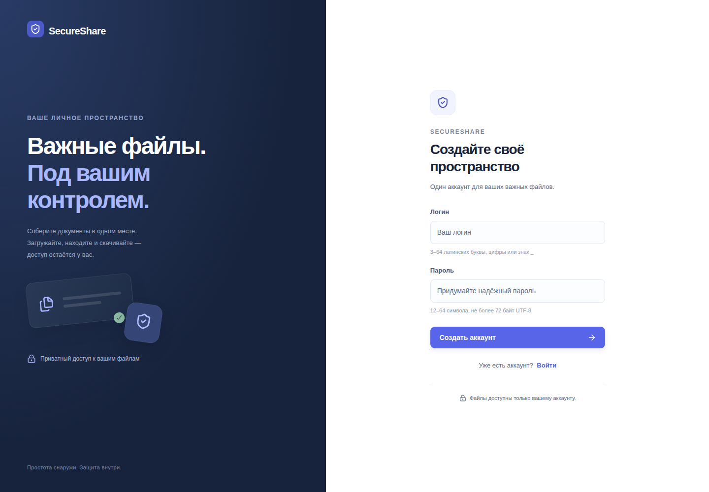
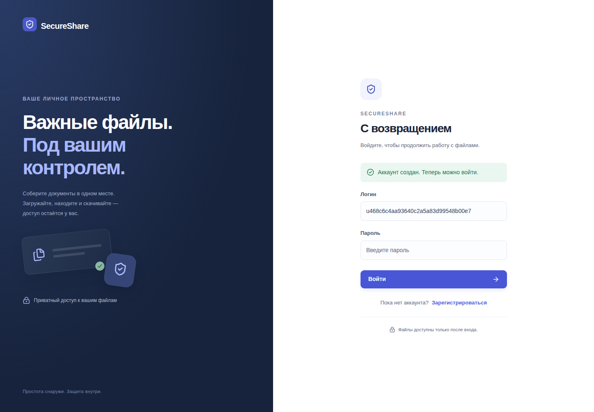
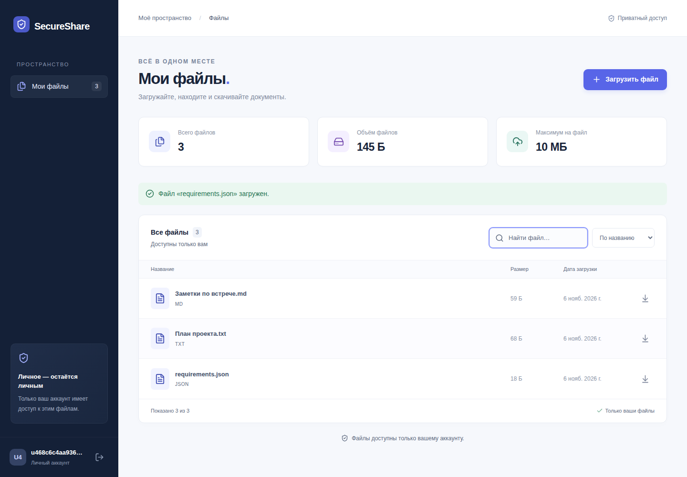
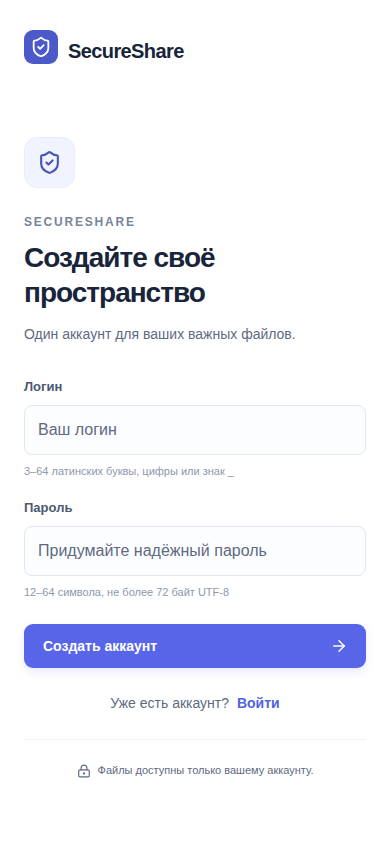
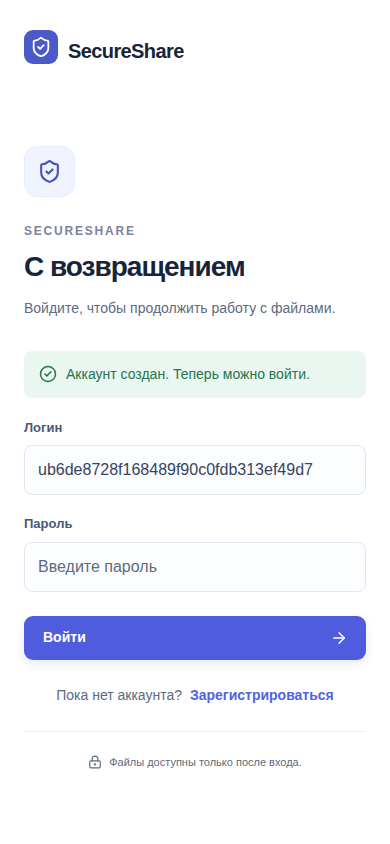
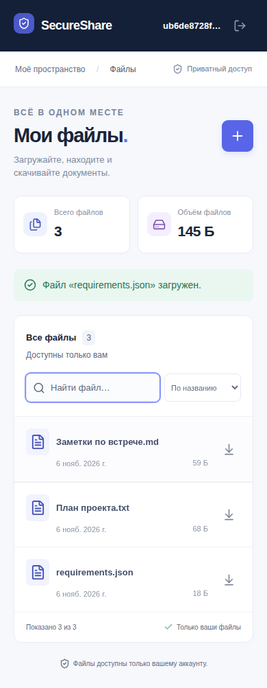

# SecureShare

Приватное файловое пространство с сессионной аутентификацией и проверкой доступа к каждому файлу. Kotlin и Spring Boot на бэкенде, React и TypeScript на фронтенде. Содержимое файлов хранится в S3, метаданные — в PostgreSQL.

[Быстрый старт](#быстрый-старт) · [Безопасность](#безопасность) · [Проверки](#проверки) · [Документация](#документация)

## Интерфейс

### Регистрация



### Вход



### Файлы

Загрузка, поиск, сортировка и скачивание файлов.



<details>
<summary>Мобильный интерфейс: регистрация, вход и файлы</summary>

#### Регистрация



#### Вход



#### Файлы



</details>

Снимки работающего приложения на тестовых данных. Как воспроизвести сценарий и обновить скриншоты — в [руководстве по разработке](docs/local-development.md).

## Возможности

- Регистрация, вход и выход с серверными сессиями.
- Загрузка файлов до 10 MiB в закрытое S3-совместимое хранилище.
- Список собственных файлов с поиском и сортировкой.
- Скачивание с проверкой владельца, размера и SHA-256.
- Диагностика запросов и ошибок PostgreSQL/S3 по `X-Request-ID`.

Сейчас доступен сценарий собственных файлов. Выдача разрешений другим пользователям, временные ссылки и отзыв доступа запланированы отдельно.

## Быстрый старт

### Требования

| Инструмент | Версия |
|---|---|
| JDK | 25 LTS |
| Node.js | 26.13+ в ветке 26; точная версия в [.nvmrc](.nvmrc) |
| npm | 12.2.2; закреплена в [package.json](package.json) |
| Docker | Работающий Docker Engine с Compose |

Gradle устанавливать отдельно не нужно: используется Wrapper. Команды выполняются из корня репозитория.

### 1. PostgreSQL и S3

```sh
docker compose up -d postgres s3
```

Compose запускает PostgreSQL и SeaweedFS с постоянными volumes. Local-профиль уже содержит соответствующие настройки; создавать `.env` для первого запуска не требуется.

### 2. Бэкенд

```sh
SPRING_PROFILES_ACTIVE=local ./gradlew :backend:bootRun
```

Бэкенд API доступен на `http://127.0.0.1:8080`; запуск из IDE не требует сборки frontend. Для запуска из IDE: JDK 25, модуль `backend.main`, main-класс `dev.secureshare.SecureShareApplicationKt`, профиль `local`.

### 3. Фронтенд — в отдельном терминале

Если используете nvm:

```sh
nvm install
nvm use
npm install --global npm@12.2.2
```

С Node.js и npm нужных версий:

```sh
npm ci
npm run dev
```

Откройте [http://127.0.0.1:5173/register](http://127.0.0.1:5173/register), создайте аккаунт и загрузите файл. Пароль: 12–64 символа, не более 72 байт UTF-8. Vite проксирует API на бэкенд; браузер работает с одним origin.

Приложения останавливаются через `Ctrl+C`. Контейнеры можно оставить работающими; `docker compose stop postgres s3` останавливает их с сохранением данных.

Порты, local credentials, переменные окружения, HTTPS и диагностика запуска — в [локальной настройке](docs/local-development.md).

## Безопасность

Сервер проверяет сессию и владельца файла при каждом обращении к файловому API. Пароли хранятся как BCrypt-хеши. Изменяющие запросы защищены CSRF; session ID меняется при входе, logout отзывает сессию. Credentials не сохраняются в localStorage.

Cookies: HttpOnly, SameSite=Lax, Secure; local разрешает HTTP на loopback. Файлы выдаются как attachment с no-store после проверки размера и SHA-256.

[Конфигурация доступа и контракты входа](docs/security-flow.md).

## Архитектура и стек

```text
Браузер → React → Spring MVC / Spring Security
                            ├── PostgreSQL: пользователи и метаданные
                            └── S3: содержимое файлов
```

Монорепозиторий: `backend/` — Kotlin / Spring Boot, `frontend/` — React / TypeScript / Vite. `docs/` содержит документацию и OpenAPI.

Spring Boot 4.1.2, Spring Security 7.1.2, Kotlin 2.4.21, React 19.3.1. Полный [стек и причины выбора совместимых версий](docs/stack.md) закреплены manifests и lockfiles.

Сборка `./gradlew bootJar` включает React в `backend/build/libs/backend-0.1.0.jar`. Собранное приложение запускается одним JVM-процессом; Node.js нужен на этапе сборки.

## Проверки

```sh
./gradlew clean check bootJar
```

Команда запускает backend-тесты, JaCoCo, проверку типов, ESLint, Prettier и frontend-тесты. Нужен Docker: интеграционные тесты создают отдельные PostgreSQL/S3-контейнеры.

Для сквозной проверки desktop/mobile после сборки jar:

```sh
python3 scripts/browser-check.py
```

Нужны Python 3 и Docker. Скрипт поднимает изолированное окружение и Chromium, проверяет реальные загрузку/скачивание и ограничения доступа, сохраняет скриншоты, затем удаляет свои контейнеры.


## Текущие ограничения

Sharing, удаление файлов, MFA, throttling и восстановление пароля пока не реализованы. Сессии хранятся в памяти одного процесса и теряются после рестарта. Автоматической очистки незавершённых загрузок нет; PostgreSQL и S3 не участвуют в общей транзакции. Шифрование файлов при хранении не настроено.

Проект пока не подготовлен к публичному развёртыванию. Local credentials предназначены для loopback-окружения. Проверка контрольных сумм зависимостей Gradle временно отключена; SHA-256 Wrapper и содержимого файлов проверяется. Подробности и возврат dependency verification — в [руководстве](docs/local-development.md).

## Документация

- [Локальный запуск, IDE и устранение ошибок](docs/local-development.md)
- [Аутентификация и доступ](docs/security-flow.md)
- [Файлы, S3 и обработка сбоев](docs/file-storage.md)
- [Архитектура React и адаптивность](docs/frontend.md)
- [Логи и диагностика по requestId](docs/logging.md)
- [OpenAPI](docs/openapi.yaml)
- [Версии зависимостей](docs/stack.md)
- [Состояние проекта и следующие этапы](docs/project.md)


## Лицензия

Код проекта распространяется под лицензией [MIT](LICENSE).
