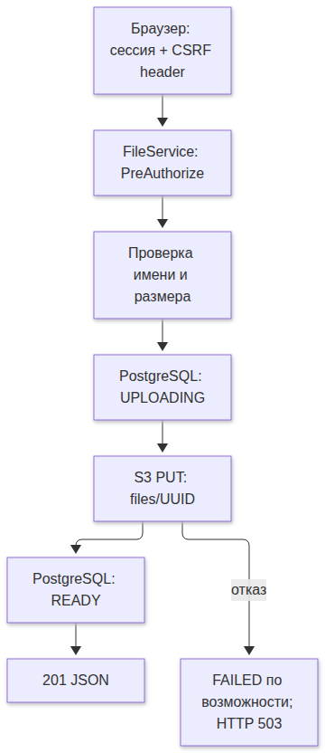
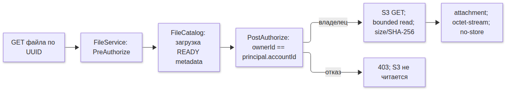

# Хранение файлов и проверка доступа

## Разделение данных

PostgreSQL хранит UUID файла, owner_id, имя, размер, SHA-256, object key, состояние и время создания. Байты файла хранятся в закрытом bucket S3. Клиенту возвращаются только id, name, sizeBytes, sha256 и createdAt.

Локально используется SeaweedFS 4.52 mini. Docker volume s3-data содержит данные хранилища, postgres-data — данные БД. Остановка контейнеров не удаляет volumes. Наружу опубликован только S3 port 8333 на loopback; внутренние master/filer/admin endpoints не публикуются.

Настройки:

| Переменная | Назначение |
|---|---|
| S3_ENDPOINT | Локально http://localhost:8333; пусто для стандартного регионального endpoint AWS |
| S3_REGION | Регион подписи SigV4 |
| S3_BUCKET | Закрытый bucket для объектов |
| S3_PATH_STYLE | true локально; значение для облака определяется провайдером |
| AWS_ACCESS_KEY_ID / AWS_SECRET_ACCESS_KEY | Локальные credentials; в облаке возможен стандартный provider chain и IAM role |

Приложение не создаёт облачные ресурсы и не меняет bucket policies. Локальный mini создаёт bucket и credentials при старте из непустого окружения. Для облака отдельно понадобятся закрытый bucket, права PutObject/GetObject, настройки TLS/endpoint и проверка совместимости выбранного провайдера.

## Загрузка

[SVG](diagrams/file-upload.svg) · [Исходник Mermaid](diagrams/file-upload.mmd)

Владелец берётся из AccountPrincipal. UUID и object key генерирует backend. Переданные клиентом ownerId, objectKey и status не участвуют в создании файла. Имя не используется как путь хранения.

## Скачивание и Method Security

[SVG](diagrams/file-download.svg) · [Исходник Mermaid](diagrams/file-download.mmd)

`FileService` требует Authentication через `@PreAuthorize("isAuthenticated()")`. `FileCatalog.loadForDownload` дополнительно проверяет владельца через `@PostAuthorize` на возвращаемой metadata.

Проверка владельца выполняется до вызова ObjectStorage. Доступ к чужому файлу, незавершённому файлу и неизвестному UUID одинаково даёт 403. Ошибка PostgreSQL при чтении metadata даёт 503.

Скачивание буферизуется в пределах лимита 10 MiB. S3 stream читается не более чем на ожидаемый размер + 1 байт и закрывается. Несовпадение размера/hash и отсутствующий READY object дают 503 до отправки HTTP 200. Ответ всегда attachment и application/octet-stream, независимо от MIME, присланного при загрузке.

## Согласованность

S3 и PostgreSQL не участвуют в общей транзакции. Внешние вызовы не удерживают транзакцию БД. Список и скачивание допускают только READY.

Если PUT завершился, но ответ потерян, объект может существовать после ошибки клиента. Если commit READY имел неясный исход, удаление объекта может разрушить уже подтверждённый файл. Поэтому при сбое сохраняются служебная запись и ключ для сверки, автоматического удаления нет. После аварий возможны UPLOADING/FAILED и неиспользуемые объекты. Reconciler и удаление файлов будут отдельной доработкой. Повторная загрузка создаёт новый UUID.

## CSRF и интерфейс

GET /files отдаёт React shell. Клиент получает masked CSRF token из /api/v1/auth/csrf и передаёт FormData с X-CSRF-TOKEN header, чтобы CsrfFilter проверил запрос до MVC multipart parsing. Токены не входят в URL. Интерфейс требует JavaScript; API доступен отдельно. CSP разрешает только ресурсы текущего origin, Referrer-Policy — no-referrer.

## Проверки

OwnFilesHttpTest проверяет владельца/постороннего, списки, multipart CSRF, подмену owner, прямой вызов Method Security, приватность S3, рестарт, повреждение объекта и HTTP/OpenAPI. FileDependencyOutageTest использует отдельные S3/PostgreSQL контейнеры для отказов. FilePolicyTest и S3StorageTest покрывают границы, ошибки чтения и неопределённую финализацию.

## Источники

- [SeaweedFS mini](https://github.com/seaweedfs/seaweedfs/wiki/Quick-Start-with-weed-mini)
- [SeaweedFS 4.52](https://github.com/seaweedfs/seaweedfs/releases/tag/4.52)
- [AWS SDK endpoint configuration](https://docs.aws.amazon.com/sdk-for-java/latest/developer-guide/endpoint-config.html)

## Ошибки приложения и MVC

InvalidFileException, FileTooLargeException и FileUnavailableException находятся в отдельных файлах пакета files. FileExceptionHandler преобразует их в 400/413/503 и формирует JSON. Он ограничен FileApiController, чтобы не менять обработку регистрации.

MultipartExceptionHandler глобальный, но обрабатывает только MaxUploadSizeExceededException: этот отказ возникает до определения controller. Authentication/authorization/CSRF ошибки filter chain обрабатывает SecurityResponses, потому что они возникают до MVC. Для отказа Method Security применяется стандартный AccessDeniedHandler и 403.
