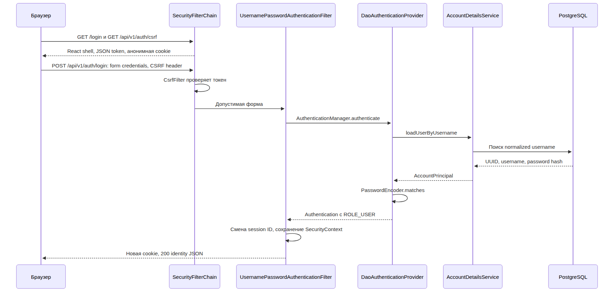

# Аутентификация и доступ

## Конфигурация

[SecurityConfiguration.kt](../backend/src/main/kotlin/dev/secureshare/security/SecurityConfiguration.kt) задаёт одну HTTP-цепочку: сессионный вход, CSRF, logout, разрешённые маршруты и защитные заголовки. Необъявленные маршруты закрыты. RequestLoggingFilter выполняется перед цепочкой и добавляет requestId.

## Вход

[SVG](diagrams/login-sequence.svg) · [Исходник диаграммы](diagrams/login-sequence.mmd)

| Операция | Контракт |
|---|---|
| Регистрация | POST `/api/v1/auth/register`, JSON username/password, CSRF; 201 без автоматического входа |
| Вход | POST `/api/v1/auth/login`, form-urlencoded username/password, CSRF; 200 с identity |
| Текущий пользователь | GET `/api/v1/me`; данные из серверной сессии |
| Выход | POST `/api/v1/auth/logout`, CSRF; 204, сессия отозвана, cookie удалена |
| CSRF | GET `/api/v1/auth/csrf`; token/headerName, no-store |

Логин: 3–64 ASCII буквы, цифры или `_`, сохраняется в нижнем регистре. Пароль: 12–64 Unicode code points, максимум 72 UTF-8 байта; без trim/normalize, хранится BCrypt-хеш. Проверка выполняется AccountDetailsService и CredentialsPolicy. Пользователю назначается ROLE_USER.

## Сессия

Хранится в памяти одного процесса, idle timeout — 30 минут. При входе session ID меняется. После login/logout клиент заново получает CSRF token. Cookies: HttpOnly, SameSite=Lax, Path=/, Secure; local разрешает HTTP на loopback. После рестарта требуется повторный вход.

На аккаунт допускается три активных сеанса. Следующий вход завершает сеанс с самой давней активностью; при равенстве учитываются время входа и публичный UUID. Повторный вход в текущем сеансе не занимает дополнительный слот.

Страница `/security` показывает время входа и последней активности, текущий сеанс и действие завершения другого сеанса. Вкладки с общей cookie используют одну запись.

| Операция | Контракт |
|---|---|
| Список | GET `/api/v1/me/sessions`; sessions с id/current/createdAt/lastSeenAt и maxSessions=3 |
| Завершение другого сеанса | DELETE `/api/v1/me/sessions/{id}` с CSRF; 204 |
| Отказ отзыва | Чужой, неизвестный или уже завершённый id — 404; текущий — 409; неверный UUID — 400 |

Публичный UUID управления отличается от JSESSIONID. Отозванный сеанс получает 401 SESSION_EXPIRED при следующем обращении, после чего интерфейс открывает вход. Уже выполняющийся запрос не прерывается. Для завершения текущего сеанса используется logout.

Реестр находится в памяти одного процесса. Список и отзыв не обращаются к PostgreSQL/S3. [ActiveSessions](../backend/src/main/kotlin/dev/secureshare/sessions/ActiveSessions.kt) хранит данные управления, [SessionAuthentication](../backend/src/main/kotlin/dev/secureshare/sessions/SessionAuthentication.kt) согласует ограничение, смену ID и регистрацию. Уничтожение HttpSession очищает запись через HttpSessionEventPublisher.

## Доступ и ошибки

- Известные UI-маршруты отдают публичный React shell без персональных данных. File API и `/me` требуют сессию.
- FileCatalog проверяет владельца metadata до чтения S3. Чужой, неизвестный или неготовый файл возвращает 403.
- Нет сессии — 401; неверные credentials — 401 INVALID_CREDENTIALS; запрет доступа или неверный CSRF — 403. CSRF проверяется до выполнения операции.
- Недоступность PostgreSQL при регистрации/login — 503. Неудачный повторный login отзывает текущую сессию. Действующий `/me` работает без чтения БД.

Ответы ошибок: `{code,message}`. HTTP-ошибки безопасности формирует [SecurityResponses.kt](../backend/src/main/kotlin/dev/secureshare/security/SecurityResponses.kt). Полный контракт — [OpenAPI](openapi.yaml), файловые операции — [хранилище](file-storage.md).
